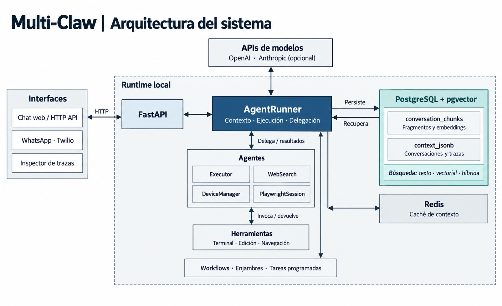

# Multi-Claw


**Agentes que ejecutan tareas, delegan trabajo y conservan una memoria consultable de lo que hicieron.**

Runtime local y experimental que combina herramientas, workflows y memoria persistente para reconstruir **qué ocurrió, cuándo y qué agente intervino**.



## Qué puedes hacer

- **Delegar tareas:** agentes especializados y enjambres con presupuestos controlados por el servidor.
- **Ejecutar trabajo:** terminal, edición de archivos, navegación con Playwright y tareas programadas.
- **Reutilizar procedimientos:** workflows versionables con instrucciones, prompts y plantillas SQL.
- **Consultar el historial:** buscar por sesión, fecha, herramienta, subagente, texto o similitud.
- **Inspeccionar ejecuciones:** conversaciones, llamadas a herramientas y árboles de agentes en una misma traza.
- **Ajustar recursos:** elegir modelos por agente y repartir contexto entre subtareas.

> Uso interno con historiales de más de 20 millones de tokens; pendiente de benchmark formal.

## Arranque rápido con Docker

Necesitas Git, Docker Compose y una clave de OpenAI con acceso a los modelos de [la configuración](agents/agent_config.json).

```bash
git clone https://github.com/ale-espa-pro/multi-claw.git
cd multi-claw
cp .env.example .env
# Edita .env: OPENAI_API_KEY y CHAT_API_KEY; cambia la contraseña de Postgres.
docker compose up --build
```

Compose crea PostgreSQL con pgvector y Redis, persiste sus datos y monta `./working-dir`.

- **Chat:** [localhost:8000](http://localhost:8000).
- **Inspector de agentes:** [localhost:8000/inspector](http://localhost:8000/inspector); admite `X-API-Key`.
- **API interactiva:** [localhost:8000/docs](http://localhost:8000/docs).

**Autenticación:** con `CHAT_API_KEY` definida, envía `X-API-Key` en las peticiones. El chat web la pide la primera vez y la recuerda en el navegador. Sin clave, la API y su terminal quedan abiertas: úsalo solo en un entorno local de confianza.

Para detener los servicios conservando datos: `docker compose down`.

## Estado y alcance

El runtime y los datos residen en tu máquina; modelos y embeddings usan APIs externas. Requiere `OPENAI_API_KEY` y PostgreSQL; Redis es recomendable. Sin pgvector se guardan embeddings, pero no hay búsqueda vectorial.

La separación de agentes y herramientas **no constituye un sandbox** ni garantiza protección frente a inyección de prompts.

## Frente a OpenClaw

Multi-Claw prioriza la **memoria de ejecución**: acciones, herramientas, delegaciones y contexto.

| Aspecto | OpenClaw | Multi-Claw |
| --- | --- | --- |
| Memoria | Archivos Markdown, notas y búsqueda | PostgreSQL, fragmentos y `context_jsonb` |
| Agentes | Espacios de trabajo y sesiones por agente | Especialistas y enjambres con trazas por nodo |
| Organización | Enrutamiento de mensajes entre agentes | Delegación de tareas y árbol de informes |

Comparación de diseño: [memoria de OpenClaw](https://docs.openclaw.ai/concepts/memory) y [enrutamiento multiagente](https://docs.openclaw.ai/concepts/multi-agent).

## Preguntas que ayuda a resolver

- «¿Qué decisión tomó el agente sobre este proyecto hace tres semanas?»
- «¿Qué subagente generó este archivo y bajo qué contrato?»
- «¿Qué herramienta falló antes de que apareciera este error?»
- «¿Dónde coinciden este tema, esta fecha y esta herramienta?»

## Configuración

[`.env.example`](.env.example) contiene los valores para Docker. Los modelos, herramientas y límites por agente se definen en [`agents/agent_config.json`](agents/agent_config.json). Los modelos `claude-*` requieren además `ANTHROPIC_API_KEY`.

**Sin Docker**, configura en `.env` tus servicios:

```env
OPENAI_API_KEY=sk-...
CHAT_API_KEY=change-me
WORKING_PATH=./working-dir

MULTIAGENT_PG_HOST=localhost
MULTIAGENT_PG_PORT=5432
MULTIAGENT_PG_DB=multiagente
MULTIAGENT_PG_USER=admin
MULTIAGENT_PG_PASSWORD=change-me
MULTIAGENT_PG_SCHEMA=multiagente

REDIS_URL=redis://localhost:6379
```

Ajustes útiles: `MEMORY_RETRIEVAL_MODE` (`vector`, `keyword` o `hybrid`), `MEMORY_QUERY_TIMEOUT_SECONDS`, `REDIS_CONTEXT_TTL_SECONDS`, `TOOL_OUTPUT_MAX_CHARS`, `TOOL_OUTPUT_HARD_MAX_CHARS`, `CONTEXT_COMPACT_OVER_CHARS` (`0` lo desactiva), `CONTEXT_CHECKPOINT_SECONDS`, `AGENT_API_CONCURRENCY`, `CORS_ORIGINS` y `ALLOWED_WRITE_ROOTS`. En Docker el servicio carga `.env`; los valores de `environment` tienen prioridad.

### Docker con servicios existentes

Copia [`docker-compose.host-db.example.yml`](docker-compose.host-db.example.yml) a `docker-compose.local.yml`. Ajusta en `.env` las variables `DOCKER_MULTIAGENT_PG_*` y `DOCKER_REDIS_URL` a tus servicios; esta variante usa la red del host.

```bash
docker compose -f docker-compose.local.yml up --build
```

### Ejecución sin Docker

Con Python 3.11+, [`uv`](https://docs.astral.sh/uv/getting-started/installation/) y PostgreSQL accesible, ejecuta desde la raíz:

```bash
uv sync --locked
uv run playwright install chromium
uv run uvicorn main:app --reload --host 127.0.0.1 --port 8000
```

Las rutas de trabajo relativas se resuelven desde la raíz del proyecto mediante `app_paths.py`.

## API

Primera petición; sustituye `change-me` por tu `CHAT_API_KEY`:

```bash
curl http://localhost:8000/chat \
  -H 'Content-Type: application/json' \
  -H 'X-API-Key: change-me' \
  -d '{"session_id":"demo","username":"usuario","message":"Hola"}'
```

`POST /chat` también acepta `conversation_type` e `images` con `url`, `path`, `data_url`, `file_id` o `base64`.

| Ruta | Función |
| --- | --- |
| `GET /conversations` | Listar conversaciones |
| `GET /conversations/{session_id}` | Leer una conversación |
| `GET /conversations/{session_id}/trace` | Consultar el árbol de agentes y sus trazas |
| `DELETE /conversations/{session_id}` | Eliminar una conversación |
| `POST /twilio/webhook` | Recibir mensajes de WhatsApp mediante Twilio |

## Cómo funciona la memoria

Los fragmentos permiten encontrar información; las trazas, reconstruir la ejecución:

1. Divide el texto conversacional en fragmentos semánticos y genera embeddings con OpenAI.
2. Guarda los fragmentos en `multiagente.conversation_chunks`.
3. Recupera información por búsqueda vectorial, palabras clave o modo híbrido.
4. Consulta `conversations.context_jsonb` cuando necesita texto literal, cronología o llamadas a herramientas.

Al empezar un turno, la entrada y salida de herramientas anterior al turno previo se envía resumida si supera 2.000 caracteres. `context_jsonb` conserva siempre el original.

El [workflow de recuperación](working-dir/workflows/memory_retrieval_tutorial/README.md) explica cómo acotar búsquedas, combinar texto y vectores y consultar el JSON.

## Enjambres de agentes

`deploy_swarm` crea agentes efímeros organizados por carpetas. El **`agent_id` es su ruta relativa**: carpetas, jerarquía y trazas comparten estructura.

```text
deploy_swarm(root_path=..., budget=12, task=...)
└── auditoria
    ├── seguridad
    │   └── dependencias
    └── rendimiento
```

- **Acceso:** cada nodo recibe `run_command` por defecto. Su carpeta organiza artefactos, pero no restringe la terminal. `allow_shell=false` retira ese acceso de la rama; sus descendientes no pueden recuperarlo. `edit_file` limita las modificaciones a la carpeta asignada y permite inspeccionar archivos externos.
- **Presupuesto:** `deploy_swarm(budget=N)` cuenta todos los agentes, raíz incluida (máximo predeterminado: 50). Al crear un hijo, `budget=k` reserva su plaza y otras `k` para descendientes: cuesta `1+k` al padre. El presupuesto no usado se devuelve al terminar.
- **Informe:** cada nodo escribe `REPORT.md` con resultados, artefactos y limitaciones; el padre recibe su contenido. Sin terminal, el agente completa un informe inicial con `edit_file` y no puede crear archivos. Si no lo completa tras un turno adicional, el resultado se marca `report_missing`.
- **Trazabilidad:** cada nodo vive una invocación, pero conserva su contexto en `context_jsonb`, consultable con `memory_query` y desde el inspector.

El bloque `_swarm` configura modelo, herramientas, profundidad, concurrencia, presupuesto e iteraciones.

## Terminal y edición de archivos

`run_command` permite leer y crear archivos, buscar y ejecutar scripts. Lo usan ExecutorAgent, DeviceManagerAgent, PlaywrightSessionAgent y, por defecto, los enjambres.

`edit_file` modifica archivos existentes con detección de conflictos:

1. `action="inspect"` con `path` devuelve contenido y `file_hash.value`. `offset` y `max_chars` permiten inspeccionar fragmentos.
2. `action="edit"` recibe `path`, `old_text` no vacío, `new_text` y `expected_file_hash`. Usa `replace_all=true` para sustituir todas las coincidencias.
3. Si cambió el archivo, devuelve `file_conflict` sin escribir: vuelve a inspeccionar antes de editar.

El hash MD5 identifica la versión completa leída, incluso al inspeccionar fragmentos. Los comandos de terminal no aplican este control.

## Stack

| Capa | Tecnología |
| --- | --- |
| API e interfaces | FastAPI, Uvicorn, chat e inspector HTML |
| Modelos | OpenAI Responses API; Anthropic opcional |
| Memoria | PostgreSQL, pgvector/HNSW, búsqueda de texto y JSONB |
| Caché | Redis |
| Automatización | Workflows, tareas programadas y enjambres |
| Integraciones | HTTP, Twilio/WhatsApp y Playwright |

## Tests

```bash
OPENAI_API_KEY=dev-only uv run python -m unittest
```

Pruebas unitarias sin llamadas a OpenAI; la clave ficticia permite inicializar clientes.

## Antes de compartir o exponer

Configura `CHAT_API_KEY`, define `CORS_ORIGINS` si accedes desde otro origen (por defecto solo `localhost`), cambia contraseñas y limita `ALLOWED_WRITE_ROOTS`. Revisa la terminal: los límites de `edit_file` no restringen comandos.

Compose publica la API y PostgreSQL (`5433`) solo en `127.0.0.1`; `APP_BIND_ADDRESS` y `POSTGRES_BIND_ADDRESS` lo cambian. Protege los puertos que expongas. No subas `.env`, claves, volcados, capturas privadas ni memoria personal; revisa `working-dir/` antes de compartirlo.

## Próximas mejoras

- Separar claramente los modos de desarrollo y producción.
- Añadir comprobaciones de salud de la API y sus dependencias.
- Automatizar pruebas unitarias y build de Docker en CI.
- Medir precisión, recuperación, coste y temporalidad de la memoria.
- Reforzar autenticación, CORS, herramientas y permisos multiusuario.

## Estructura

```text
.
├── main.py                  # API y arranque
├── app_paths.py             # Resolución de rutas
├── index.html / inspector.html
├── docs/architecture.png
├── agents/                  # Configuración y prompts
├── runner/                  # Ejecución, contexto y enjambres
├── providers/               # OpenAI y Anthropic
├── tools/memoryTools/       # Fragmentación y recuperación
├── data/                    # Persistencia y trazas
├── integrations/twilio/
├── tests/
├── working-dir/             # Artefactos, memoria y workflows
├── Dockerfile
└── docker-compose.yml
```
